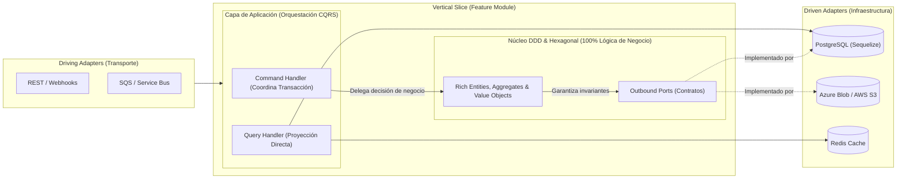

  <!-- Efecto de título animado (Typing SVG) -->
  

  

    
    
    
  

---

### ⚡ Sobre mí

Diseño y construyo **sistemas backend distribuidos, transaccionales y nativos de la nube**. Mi enfoque principal es el **Domain-Driven Design (DDD)** con **Modelos de Dominio Ricos**, donde el **100% de la lógica de negocio, invariantes y transiciones de estado viven encapsulados dentro de las Entidades y Agregados**, mientras que las capas externas (**CQRS**, casos de uso e infraestructura) se limitan estrictamente a orquestar, persistir y transportar.

Combino **DDD + Arquitectura Hexagonal (Ports & Adapters) + Vertical Slice Architecture** sobre **AWS** y **Azure**, potenciando el ciclo de ingeniería mediante **Spec-Driven Development (SDD)**, **Agent Skills** y servidores **MCP (Model Context Protocol)**.

---

### 🛠️ Ecosistema Técnico & Cloud

#### **Core Backend, Arquitectura & Persistencia**

  
  
  
  
  
  
  
  
  

#### **Amazon Web Services (AWS Backend Stack)**

  
  
  
  
  
  
  
  

#### **Microsoft Azure (Enterprise Cloud Stack)**

  
  
  
  
  
  

#### **AI-Native Engineering & Agentic Workflows**

  
  
  
  

---

### 🏛️ Arquitectura & Ingeniería de Software

Construyo sistemas bajo la sinergia de **DDD (Domain-Driven Design)**, **Vertical Slice Architecture**, **Arquitectura Hexagonal** y **CQRS**, erradicando el antipatrón de *Modelo de Dominio Anémico*.

- **DDD & Rich Domain Models (Cero Modelos Anémicos):** Las entidades y *Aggregate Roots* concentran el **100% de las reglas de negocio**, cálculos e invariantes mediante métodos de comportamiento expresivos y *Value Objects* inmutables. Ninguna entidad expone mutaciones arbitrarias fuera de sus reglas de dominio.
- **Capas Externas como Orquestadores Puros:** Los *Command Handlers* (Aplicación) no toman decisiones de negocio; únicamente hidratan el agregado a través de los *Ports*, invocan el comportamiento de la entidad y coordinan la persistencia transaccional (*Unit of Work*) o la emisión de eventos.
- **Hexagonal + Vertical Slicing:** Cada capacidad de negocio vive aislada en su propio *Slice*. El dominio no conoce de `Sequelize`, `AWS SDK` ni `@azure/storage-blob`.
- **CQRS (Write vs. Read Model):** Escrituras gobernadas por el modelo rico de dominio con garantías **ACID** en PostgreSQL, y lecturas desacopladas mediante *Queries* de baja latencia.
- **Spec-Driven Development (SDD) & Agent Skills:** Especificaciones técnicas formales y **Skills para agentes de IA** que obligan a respetar las fronteras del dominio, contratos de puertos y cobertura de pruebas desde la generación del código.

---

### 🚀 Enfoque Actual

- 🧾 **Motores de Facturación Electrónica & Core Transaccional ([Factus](https://github.com/dbritto/Factus_facturacion_electronica)):** Implementación con **DDD + Hexagonal Architecture + CQRS + Vertical Slice**, persistencia ACID en **PostgreSQL (Sequelize)** y resguardo criptográfico de XML/PDF en **Azure Blob Storage**.
- ☁️ **Arquitecturas Cloud Híbridas (AWS & Azure):** Procesamiento distribuido basado en eventos (**SQS / SNS / EventBridge / Azure Service Bus**), almacenamiento seguro con **S3 / Blob Storage** (*SAS Tokens & Presigned URLs*) y cómputo serverless.
- 🤖 **Ingeniería Basada en Especificaciones (SDD) & Ecosistema Agentic:** Creación de **Agent Skills** personalizadas, reglas de contexto arquitectónico y automatización de pipelines de desarrollo guiados por especificaciones técnicas verificables.

---

### 📈 Actividad de Commits & Métricas en Tiempo Real

  <!-- Gráfica de Actividad de Commits + Resumen General (Servidor Estable) -->
  

   

  <!-- Racha de Commits (Streak), Estadísticas y Lenguajes por Commit -->
  
  
  

    

  <!-- Mapa de Calor de Contribuciones personalizado en Azul Cian -->
  

