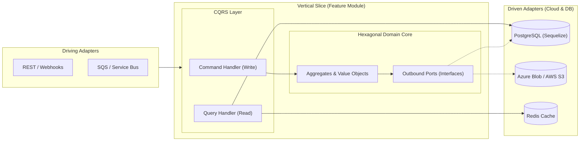

  <!-- Efecto de título animado (Typing SVG) -->
  

  

    
    
    
  

---

### ⚡ Sobre mí

Diseño y construyo **sistemas backend distribuidos, transaccionales y nativos de la nube**. Mi trabajo se centra en crear plataformas donde las reglas de negocio críticas están protegidas mediante **Arquitectura Hexagonal (Ports & Adapters)**, **Vertical Slice Architecture** y **CQRS**, desplegadas sobre infraestructuras resilientes en **AWS** y **Azure**.

Integro flujos de **Ingeniería Asistida por IA de nivel empresarial**: **Spec-Driven Development (SDD)**, diseño de **Agent Skills**, servidores **MCP (Model Context Protocol)** y automatización determinista para acelerar el ciclo de vida de arquitectura, pruebas y despliegue sin sacrificar calidad ni seguridad.

---

### 🛠️ Ecosistema Técnico & Cloud

#### **Core Backend & Persistencia**

  
  
  
  
  
  
  
  

#### **Amazon Web Services (AWS Backend Stack)**

  
  
  
  
  
  
  
  

#### **Microsoft Azure (Enterprise Cloud Stack)**

  
  
  
  
  
  

#### **AI-Native Engineering & Agentic Workflows**

  
  
  
  

---

### 🏛️ Arquitectura & Ingeniería de Software

Organizo los sistemas combinando **Vertical Slice Architecture**, **Arquitectura Hexagonal** y **CQRS**, asegurando que cada capacidad de negocio sea independiente, auditable y desacoplada de proveedores cloud u ORMs.

- **Hexagonal + Vertical Slicing:** El dominio tributario, financiero o transaccional no conoce de `Sequelize`, `AWS SDK` ni `@azure/storage-blob`. Los adaptadores implementan contratos estrictos (Puertos) dentro de cada *Slice*.
- **CQRS & Consistencia Eventual/ACID:** Separación entre mutaciones transaccionales (bloqueos de fila, control de idempotencia, *Unit of Work*) y proyecciones de lectura de baja latencia.
- **Spec-Driven Development (SDD) & Agent Skills:** Definición de especificaciones formales, contratos de arquitectura, *guardrails* y **Skills reutilizables para agentes de IA** que estandarizan la generación de código, migraciones, pruebas de integración y validación de reglas de dominio.

---

### 🚀 Enfoque Actual

- 🧾 **Motores de Facturación Electrónica & Core Transaccional ([Factus](https://github.com/dbritto/Factus_facturacion_electronica)):** Implementación con **Hexagonal Architecture + CQRS + Vertical Slice**, persistencia ACID en **PostgreSQL (Sequelize)** y resguardo criptográfico de XML/PDF en **Azure Blob Storage**.
- ☁️ **Arquitecturas Cloud Híbridas (AWS & Azure):** Procesamiento distribuido basado en eventos (**SQS / SNS / EventBridge / Azure Service Bus**), almacenamiento seguro con **S3 / Blob Storage** (*SAS Tokens & Presigned URLs*) y cómputo serverless.
- 🤖 **Ingeniería Basada en Especificaciones (SDD) & Ecosistema Agentic:** Creación de **Agent Skills** personalizadas, reglas de contexto arquitectónico y automatización de pipelines de desarrollo guiados por especificaciones técnicas verificables.

---

### 📈 Actividad de Commits & Métricas en Tiempo Real

  <!-- Tarjetas de Estadísticas y Racha de Commits (Streak) -->
  
  

   

  <!-- Gráfica de Actividad de Commits en Tiempo Real -->
  

